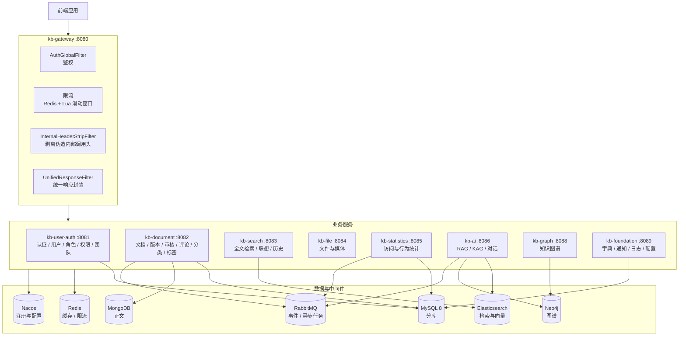
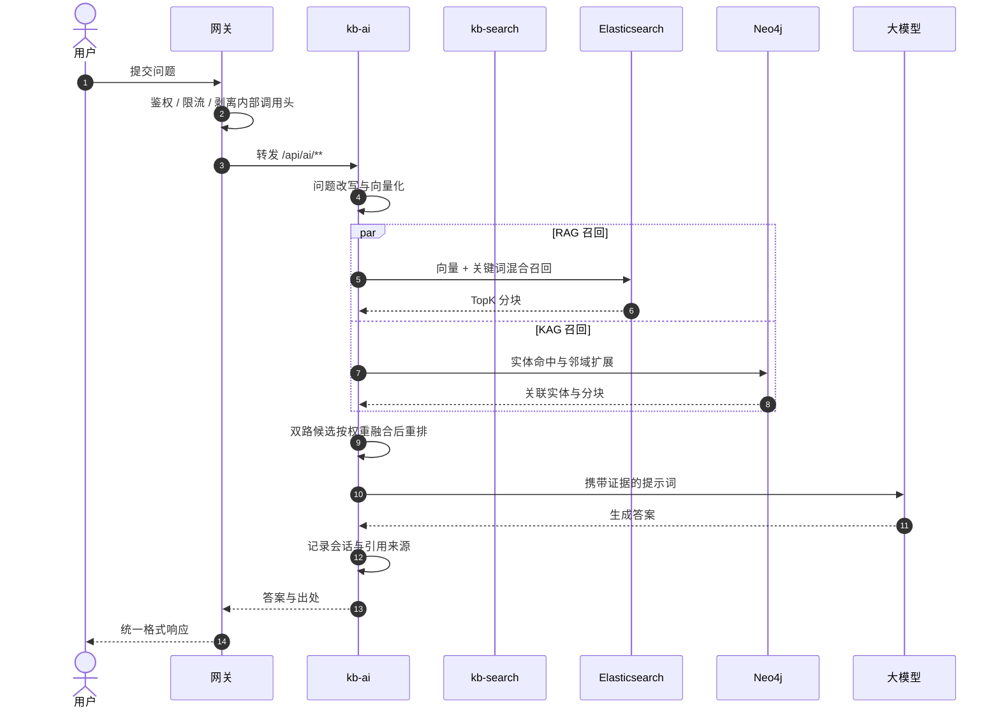

<div align="center">
  <h2>Knowledge Base</h2>

  <p>
    
    
    
    
    
    
    
    
    
    <a href="./LICENSE"></a>
  </p>
</div>

<div align="center">

面向企业文档场景的 <strong>知识库后端</strong>。

致力于把分散的文档沉淀成可检索、可追溯、可追问的组织知识。

</div>

## 项目简介

一套 Spring Cloud Alibaba 微服务后端，把「文档怎么写、怎么审、怎么找、怎么问」串成一条链路：文档服务管生命周期，检索服务负责关键词与向量召回，图服务沉淀实体关系，AI 服务在检索结果之上做增强生成。所有对外流量统一经网关进入，鉴权、限流、响应格式都在网关收敛。

9 个可运行服务 + 1 个公共模块，每个业务服务独立数据库，通过 Nacos 注册发现与 Feign 互通。

## 核心功能

知识库的难点不在于「存文档」，而在于**文档是有权限的、正文是有版面的、检索是要求出处的**。下面四层能力都围绕这三点展开。

### 📚 文档全生命周期

> 把一篇文档从上传、编写、审核到共享、归档收进同一条数据链路，而不是散在多个系统里。

- **正文与元数据分离** — 元数据、权限、版本号落 MySQL；正文与自动保存历史落 MongoDB，避免大文本撑爆关系库。
- **版本与审核** — 每次编辑产出可回溯版本；提交审核后进入审核态，审核记录保留审核人与意见，支持驳回再提交。
- **协作要素** — 分类、标签、评论、收藏、分享链接各自独立成表，文档与它们的关联都带逻辑删除字段。
- **访问控制** — 文档级 ACL 与团队隔离，检索链路同样会过一遍 ACL，避免「搜得到但打不开」。
- **批量导入** — 支持目录批量导入；扫描件与复杂版面 PDF 交给可选的 MinerU 解析，未启用或失败时自动回退 Java 原生 PDFBox / POI。

### 🔍 混合检索与知识图谱

> 关键词解决「精确匹配」，向量解决「意思相近」，图谱解决「它和谁有关」。

- **全文检索** — Elasticsearch 承载文档索引，支持高亮、联想补全与搜索历史。
- **权限过滤** — 检索前按 ACL 过滤候选集，而不是返回后再剔除，避免条数被无效结果占满。
- **图谱建模** — Neo4j 保存实体、关系、文档与分块之间的从属结构，支持子图查询、路径查询与社区划分。
- **图谱缓存** — 图谱查询结果单次可达数百 KB，走 Redis 需额外序列化与网络往返，实测反而更慢，因此改用进程内 Caffeine 缓存并显式说明取舍。

### 🤖 RAG 与 KAG 双引擎

> 检索增强保证答案有出处，图谱增强补齐跨文档的关系推理。

- **RAG 链路** — 段落感知分块（默认 512 / 重叠 64），`text-embedding-v3` 生成 1024 维向量写入 ES；召回首取 20 条，经 RRF（`c=60`）融合后重排，最终取 5 条作为上下文。
- **KAG 链路** — 由大模型从分块中抽取实体与关系（每块上限 10 实体 / 15 关系），去重后写入 Neo4j；回答时按 `max-hops` 做邻域扩展再回到原始分块。
- **双路融合** — RAG 与 KAG 的候选按 0.5 / 0.5 加权合并后统一重排，任一路不可用时另一路独立可用。
- **异步索引** — 重建索引与图谱构建走 RabbitMQ 异步任务，失败可重试；索引进度与重入由独立接口控制。
- **模型可换** — 默认通义千问 `qwen-max`，也可切 `deepseek-chat`；未配置 API Key 时模型列表为空，AI 入口明确降级而不是报 500。

### 🛡️ 认证、权限与可观测

> 网关是唯一入口，把鉴权、限流、防伪造都收在这一层，服务内部只做业务判断。

- **JWT 双令牌** — 访问令牌 2 小时、刷新令牌 7 天；配套邮箱激活与密码找回，未配置邮件时注册仍可用，仅激活需人工处理。
- **RBAC** — 用户、角色、权限、团队四张主表，权限点可挂到接口上。
- **限流** — Redis + Lua 滑动窗口，网关与业务服务使用同一套算法，避免固定窗口的边界突刺；网关侧走 reactive Redis 以免阻塞事件循环，Redis 不可用时的放行/拒绝可配置。
- **防伪造内部调用** — 服务间用 `INNER-REQUEST` 头识别内部调用，网关在入口统一剥离该头，外部客户端无法冒充内部流量。
- **统一出口** — `Result` 统一返回体 + 全局异常处理；网关再做一次响应封装与 CORS 头去重，前端只需适配一种格式。
- **可观测** — SkyWalking 链路追踪，日志带 `[TID:xxx]` 可直接回查同一条链路。

## 系统架构



## 系统流程

以「向知识库提问」为例，一次回答要同时经过检索、图谱扩展与模型生成：



## 技术栈

| 层次 | 技术 | 用途 |
| :--- | :--- | :--- |
| 框架 | Java 21、Spring Boot 3.2.0、Spring Cloud 2023.0.0、Spring Cloud Alibaba 2023.0.1.0 | 微服务基础与依赖版本管理 |
| 网关 | Spring Cloud Gateway（WebFlux）、Reactive Redis | 路由、鉴权、限流、统一响应与 CORS |
| 注册与配置 | Nacos | 服务注册发现、按电脑标识隔离实例组、配置中心 |
| 数据访问 | MyBatis-Plus 3.5.8、Druid 1.2.20、Spring Data MongoDB、Spring Data Neo4j、Spring Data Elasticsearch | 关系库、文档库、图库与索引访问 |
| 检索 | Elasticsearch 8 | 全文检索、向量召回、高亮与联想 |
| 图谱 | Neo4j 5 | 实体关系建模、子图与路径查询 |
| 消息 | RabbitMQ | 统计事件、异步索引与图谱构建 |
| AI | 通义千问（DashScope 兼容接口）、DeepSeek | 对话、实体关系抽取、Embedding 与重排 |
| 安全 | JWT（jjwt 0.12.3）、RBAC、邮箱激活 | 认证授权与账号生命周期 |
| 文件 | RustFS（S3 兼容）、FFmpeg | 对象存储、视频转码与 HLS 切片 |
| 可观测 | SkyWalking 9.0.0 | 链路追踪与 traceId 贯穿 |
| 文档 | Knife4j 4.3.0 | 在线接口文档 |

## 模块与端口

| 模块 | 端口 | 职责 |
| :--- | :--- | :--- |
| `kb-gateway` | 8080 | 统一入口：路由、鉴权、限流、响应封装 |
| `kb-user-auth` | 8081 | 登录注册、邮箱激活、用户、角色、权限、团队 |
| `kb-document` | 8082 | 文档、版本、审核、评论、分类、标签、分享、收藏、批量导入 |
| `kb-search` | 8083 | 全文检索、联想补全、搜索历史 |
| `kb-file` | 8084 | 文件上传下载、分类、视频转码与预览 |
| `kb-statistics` | 8085 | 访问统计、趋势、热榜、聚合任务 |
| `kb-ai` | 8086 | RAG、KAG、对话、写作、建议与反馈 |
| `kb-graph` | 8088 | 知识图谱查询与统计 |
| `kb-foundation` | 8089 | 字典、通知（含 WebSocket）、操作日志、系统配置 |
| `kb-common` | — | 公共返回体、异常、注解、切面、工具与 Feign 配置 |

## 快速开始

### 环境要求

| 组件 | 版本 | 必要性 | 说明 |
| :--- | :--- | :--- | :--- |
| JDK | 21 | 必需 | 编译与运行环境 |
| Maven | 3.8+ | 必需 | 多模块构建 |
| MySQL | 8.0+ | 必需 | 7 个业务库，需先建库导数据 |
| Redis | 6.0+ | 必需 | 缓存、限流、实时计数器 |
| Elasticsearch | 8.x | 必需 | 文档检索与 RAG 向量索引 |
| RabbitMQ | 3.x | 必需 | 统计事件与异步索引 |
| Nacos | 2.x | 必需 | 注册发现与配置中心 |
| MongoDB | 6.0+ | 必需 | 文档正文与自动保存历史 |
| Neo4j | 5.x | 必需 | KAG 图谱存储 |
| RustFS | S3 兼容 | 建议 | 文件与媒体存储，仅文件服务依赖 |
| FFmpeg | 可在终端调用 | 可选 | 视频转码、HLS 切片与封面 |
| MinerU | 独立 Python 服务 | 可选 | 扫描件 PDF 版面解析，未启用则回退原生解析 |

> 中间件默认都按 `127.0.0.1` 连接，需在本机或可访问的地址自行准备；仓库不含 Docker Compose，请按各自模块的 `application.yml` 逐项核对端口。

### 1. 初始化数据库

```sql
CREATE DATABASE IF NOT EXISTS `kb_user`       DEFAULT CHARACTER SET utf8mb4 COLLATE utf8mb4_unicode_ci;
CREATE DATABASE IF NOT EXISTS `kb_document`   DEFAULT CHARACTER SET utf8mb4 COLLATE utf8mb4_unicode_ci;
CREATE DATABASE IF NOT EXISTS `kb_search`     DEFAULT CHARACTER SET utf8mb4 COLLATE utf8mb4_unicode_ci;
CREATE DATABASE IF NOT EXISTS `kb_file`       DEFAULT CHARACTER SET utf8mb4 COLLATE utf8mb4_unicode_ci;
CREATE DATABASE IF NOT EXISTS `kb_ai`         DEFAULT CHARACTER SET utf8mb4 COLLATE utf8mb4_unicode_ci;
CREATE DATABASE IF NOT EXISTS `kb_statistics` DEFAULT CHARACTER SET utf8mb4 COLLATE utf8mb4_unicode_ci;
CREATE DATABASE IF NOT EXISTS `kb_foundation` DEFAULT CHARACTER SET utf8mb4 COLLATE utf8mb4_unicode_ci;
```

`sql/` 目录提供了全量导出脚本（含建表与初始化数据），可直接导入：

```bash
mysql -u root -p < sql/knowledge_base_export_2026-06-23.sql
```

脚本会自行 `CREATE DATABASE` 并 `USE` 对应库，导入完成后上述 7 个库即为可用状态。

### 2. 准备配置

```bash
cp .env.example .env
```

按需填写 `.env`。除邮件与模型 Key 外，多数配置可在 `application.yml` 中找到同名环境变量占位符，不改代码即可覆盖：

| 变量 | 作用 | 默认值 |
| :--- | :--- | :--- |
| `COMPUTER_ID` | Nacos 实例分组，多台机器需唯一 | 系统用户名 |
| `MYSQL_USERNAME` / `MYSQL_PASSWORD` | 数据库账号 | `root` / `123456` |
| `JWT_SECRET` | 令牌签名密钥 | 内置开发默认值 |
| `QWEN_API_KEY` / `QWEN_MODEL` | 通义千问 Key 与模型 | 空 / `qwen-max` |
| `DEEPSEEK_API_KEY` | DeepSeek Key | 空 |
| `RAG_ENABLED` / `RAG_CHUNK_SIZE` / `RAG_CHUNK_OVERLAP` | RAG 开关与分块参数 | `true` / `512` / `64` |
| `RAG_EMBEDDING_MODEL` | 向量模型 | `text-embedding-v3` |
| `KAG_ENABLED` / `KAG_MAX_HOPS` / `KAG_EXTRACTION_BATCH_SIZE` | KAG 开关与图谱参数 | `true` / `2` / `5` |
| `ELASTICSEARCH_URIS` / `NEO4J_URI` | 检索与图库地址 | `http://127.0.0.1:9200` / `bolt://localhost:7687` |
| `NEO4J_USERNAME` / `NEO4J_PASSWORD` | Neo4j 账号 | `neo4j` / 见 `.env.example` |
| `RUSTFS_ACCESS_KEY` / `RUSTFS_SECRET_KEY` | 对象存储密钥，**不配置则文件服务上传失败** | 空 |
| `MAIL_HOST` / `MAIL_PORT` / `MAIL_USERNAME` / `MAIL_PASSWORD` | SMTP 发信配置 | `smtp.163.com` / `465` / 空 / 空 |
| `APP_FRONTEND_URL` | 激活与重置链接的前端地址 | `http://localhost:3002` |

邮箱需使用 **SMTP 授权码**而非登录密码；未配置邮件时注册功能仍可用，只是账号需人工激活，密码找回不可用。

Redis、RabbitMQ、MongoDB、Nacos 的地址与口令目前直接写在各模块 `application.yml` 中（默认 `127.0.0.1`，口令见 `.env.example` 说明），需要改动时请直接编辑对应文件。

### 3. 启动服务

先构建全部模块：

```bash
mvn clean install -DskipTests
```

再按依赖顺序启动（网关最后，避免路由转发时后端尚未就绪）：

```bash
mvn -pl kb-user-auth  spring-boot:run
mvn -pl kb-document   spring-boot:run
mvn -pl kb-search     spring-boot:run
mvn -pl kb-file       spring-boot:run
mvn -pl kb-ai         spring-boot:run
mvn -pl kb-graph      spring-boot:run
mvn -pl kb-statistics spring-boot:run
mvn -pl kb-foundation spring-boot:run
mvn -pl kb-gateway    spring-boot:run
```

每个进程在控制台打印注册结果，Nacos 控制台（默认 `http://localhost:8848/nacos`）中应能看到同名服务实例。

需要额外挂载链路追踪 Agent 时，可用仓库根目录的脚本一次拉起全部服务：

```bash
./start-with-skywalking.sh
```

### 4. 验证

网关是唯一入口，业务路径都带服务前缀，且除认证相关接口外均需要携带访问令牌：

```bash
# 1. 登录取 token
curl -X POST http://localhost:8080/api/auth/auth/login \
  -H "Content-Type: application/json" \
  -d '{"username":"admin","password":"123456"}'

# 2. 带 token 发起检索
curl -X POST http://localhost:8080/api/search \
  -H "Content-Type: application/json" \
  -H "Authorization: Bearer <accessToken>" \
  -d '{"keyword":"知识库","current":1,"size":10}'
```

在线接口文档有两个入口：

- 各服务直连：`http://localhost:<端口>/doc.html`
- 经网关访问基础服务：`http://localhost:8080/api/foundation/doc.html`

### 常见问题

| 现象 | 处理方式 |
| :--- | :--- |
| 启动时 Nacos 报连接失败 | 确认 8848 端口可达；配置中心使用 `optional:nacos:` 前缀，拉不到配置不会阻断启动，但注册失败会导致网关 503 |
| MySQL 报 `Access denied` | 覆盖 `MYSQL_USERNAME` / `MYSQL_PASSWORD`，或直接改对应模块 `application.yml` |
| 文件上传报 403 / 签名错误 | `RUSTFS_ACCESS_KEY`、`RUSTFS_SECRET_KEY` 未配置，或 bucket 不存在 |
| AI 返回 404 `Model not exist` | `QWEN_MODEL` 填错；DashScope 上不存在 `qwen3-max`，默认请用 `qwen-max` |
| AI 接口返回 401 / 模型不可用 | 检查 `QWEN_API_KEY`、`DEEPSEEK_API_KEY`，修改后需重启 kb-ai |
| 关键词搜索偶发 `Operation timed out` | ES 客户端超时已放宽为连接 5s / 读取 60s，仍超时通常是 ES 未就绪或索引未建 |
| 前端跨域报错 | 网关默认放行全部来源（`allowedOriginPatterns: "*"`）；若前端需携带 Cookie，浏览器不允许 `*` 与凭证并用，需在 `CorsConfig` 中收紧为具体域名 |
| 网关 503 且后端日志正常 | 后端未注册到同一 Nacos 分组；确认各服务 `COMPUTER_ID` 一致 |
| 端口冲突 | `8087` 未被占用，可按模块表调整；网关固定 8080 供前端调用 |

## 目录结构

```text
knowledge-base-backend
├── kb-common/          # 公共返回体、异常、注解、切面、工具、Feign 配置
├── kb-gateway/         # 网关：路由、鉴权、限流、响应封装
├── kb-user-auth/       # 认证与权限
├── kb-document/        # 文档主域
├── kb-search/          # 检索
├── kb-file/            # 文件与媒体
├── kb-ai/              # RAG / KAG / 对话
├── kb-graph/           # 知识图谱
├── kb-statistics/      # 统计
├── kb-foundation/      # 字典、通知、日志、配置
├── sql/                # 建库建表与初始化数据
├── .env.example        # 环境变量模板
└── start-with-skywalking.sh  # 一键挂 SkyWalking 启动全部服务
```

## License

本项目基于 [MIT License](LICENSE) 开源。
